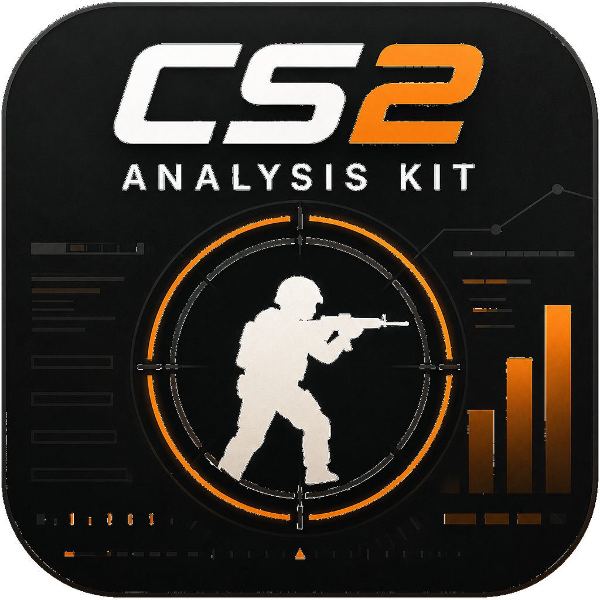

<div align="center">



# CS2 Demo Analysis Kit

**Local-first CS2 demo analysis — every stat links back to the exact round and tick.**

English · [简体中文](./README.zh-CN.md)

[](https://github.com/Starfie1d1272/cs2-demo-analysis-kit/actions)
[](https://github.com/Starfie1d1272/cs2-demo-analysis-kit/releases/latest)
[](#license)
[](https://pypi.org/project/cs2df/)

</div>

---

**DAK Studio** is a desktop workbench that turns a CS2 `.dem` into a full analysis session: a 2D replay, per-player profiles, duel & mechanics breakdowns, utility and economy labs, a tournament hub, and a coach workbench. Everything runs and stays on your machine — no account, no upload, no server.

This repository is also the product-neutral pipeline **behind** Studio: a set of `@cs2dak/*` packages that take a `cs2-demo-format/3.x` ZIP and produce reusable analysis and view models, consumed by Studio and by other products such as RivalHub and CS2 Insight Agent.

> **Query-first, no black boxes.** Every number in Studio links back to the exact match, round, and tick — and you can watch it happen in the 2D replay. We derive signals transparently; we never ship a score you can't trace.

## Download

Grab the latest build from [**Releases**](https://github.com/Starfie1d1272/cs2-demo-analysis-kit/releases/latest):

| Platform | File | First launch |
|---|---|---|
| macOS | `dak-studio-X.Y.Z.dmg` | Drag to Applications → System Settings → Privacy & Security → **Open Anyway** (currently unsigned) |
| Windows | `DAK-Studio-Setup-X.Y.Z.exe` | Run the installer, choose an install folder, click **Run anyway** on SmartScreen |

Windows portable users can use `dak-studio-windows-X.Y.Z-full.zip`. It includes the runtime and bundled tournament data, but `.tri` collision geometry is downloaded separately when needed; geometry-dependent analysis degrades when unavailable. The smaller `dak-studio-windows-X.Y.Z.zip` is runtime-only and mainly for troubleshooting.

If you installed an RC with the same numeric version, install the stable build manually; an update notification is not guaranteed. Back up your data before upgrading. For 0.8.5 or earlier on Windows, close Studio and run the installer against the existing install directory; it preserves user data. See [release notes](CHANGELOG.md) and [release instructions](docs/release.md).

The exporter is built in — click **导入 demo**, pick `.dem` files (or v3 ZIPs), and parsing happens locally. No extra tooling required.

## What Studio does

Nine modules over one shared evidence layer (2D replay · round filters · evidence links). Full module map: [docs/design/studio-redesign.md](docs/design/studio-redesign.md). Per-module maturity (Stable / Beta / Experimental): [docs/stability-tiers.md](docs/stability-tiers.md).

| Module | What it answers |
|---|---|
| **Home** | "How have *I* been playing, and what should I practice this week?" |
| **Library** | Where are my demos, how good is the data, how is it organized? (import, hash-dedup, tags, series grouping, QA) |
| **Match workspace** | What happened this match, and which round and tick proves it? (replay, scoreboard, kill feed, economy, RR breakdown) |
| **Duel & Mechanics Lab** | Why did I lose that gunfight — aim, positioning, or reaction? (`.tri` line-of-sight TTK, first-shot / spray / counter-strafe / preaim) |
| **Player** | What's this player's style, are they improving, where are the mistakes? |
| **Utility Lab** | Was that nade worth it, did I learn the standard lineups? |
| **Economy & Round Flow** | Was the money spent right, where did the tempo break? |
| **Tournament Hub** | Who's strong, what maps are popular, how do I publish the report? |
| **Coach Workbench** | What will the opponent run, what do we prepare? *(early — see stability tiers)* |

## Architecture

```text
.dem → cs2df → v3 ZIP → @cs2dak/demo-io → DemoPackage
  → @cs2dak/core          canonical single-match facts and QA
  → @cs2dak/tactics       spatial / engagement analysis and tactical clustering
  → @cs2dak/analytics     rating signals, insights and UI projections
  → @cs2dak/rating        RR / PRISM formula adapter
  → @cs2dak/cohort        aggregation of supplied rating rows

@cs2dak/pipeline          orchestrates the complete analysis workflow
existing UI data → @cs2dak/presentation → @cs2dak/react → host product
```

The v3 ZIP is the only Python/TypeScript seam. Each consumer selects the capability it needs; Core facts, ratings, map assets and UI have separate installation boundaries.

| Package | Role |
|---|---|
| `@cs2dak/contract` | Input and basic fact schemas; compiles the pinned original format schema and declarations for distribution. |
| `@cs2dak/demo-io` | ZIP loading, stream selection and input diagnostics. |
| `@cs2dak/core` | Canonical event attribution, facts, QA and frozen Tournament projection; no loader, rating or map dependency. |
| `@cs2dak/rating` | RR/PRISM DTOs and formula adapter; inputs are supplied signals. |
| `@cs2dak/cohort` | Supplied-row aggregation, identity merging and cohort RR/PRISM. |
| `@cs2dak/maps` | Asset-independent calibration and spatial algorithms. |
| `@cs2dak/map-assets` | Map data and explicit Node/browser asset loaders. |
| `@cs2dak/tactics` | Spatial and engagement analysis, map-role evidence and tactical clustering. |
| `@cs2dak/tournament` | Frozen facts DTOs, identity-safe cross-map aggregation and aggregation-safety guards. |
| `@cs2dak/analytics` | Cross-domain signal derivation, insights and existing-results-to-UI projection. |
| `@cs2dak/pipeline` | Raw DemoPackage analysis and multi-match orchestration. |
| `@cs2dak/presentation` | Display models, formatting and labels; depends on maps and Zod. |
| `@cs2dak/react` | Reusable components with scoreboard, table and replay subpaths. |
| `@cs2dak/cli` | Private filesystem adapter for demo-io and pipeline. |
| `apps/dak-studio` / `python/src/cs2dak` | Local workbench, desktop bridge and packaging shell. |

```tsx
import { useState } from 'react';
import { createReplayViewState, type MapView, type WorkspaceReplay } from '@cs2dak/presentation';
import { ReplayViewer } from '@cs2dak/react/replay';
import '@cs2dak/react/theme.css';

export function Replay({ replay, map }: { replay: WorkspaceReplay; map: MapView }) {
  const [state, setState] = useState(() => createReplayViewState(replay, map));
  return <ReplayViewer replay={replay} map={map} state={state} onStateChange={setState} />;
}
```

For raw DemoPackage input, use `pipeline.analyzeMatchWorkspace(input, options?)`. For existing package/bundle/canonical facts, use `analytics.buildMatchWorkspaceFromAnalysis(pkg, bundle, facts, options?)`. Studio owns its match workspace composition; public React tables and replay are controlled by the host. See [React migration](docs/migrations/react-controlled-state.md). The host supplies radar image URLs through `DemoViewOptions`; omitted URLs are null. See [architecture](docs/architecture.md) for the public entry points and [module boundaries](docs/module-boundaries.md) for the enforced graph.

## Develop

```bash
pnpm install
pnpm typecheck         # builds compiled workspace packages and checks types
pnpm dev:studio        # DAK Studio (port 5178, .dem import via local uv env)
pnpm dev               # alias for pnpm dev:studio
pnpm test              # fast Vitest suite (excludes *.integration.test.ts)
pnpm test:integration  # critical flows: real ZIP import, required-stream rejection, optional-stream fallback
pnpm test:all          # everything
pnpm analyze:sample    # CLI analysis of the sample ZIP → fixtures/output/sample/
bash scripts/package.sh  # package the desktop app (DMG / exe)
```

Demo export uses the `cs2df` CLI directly:

```bash
cd python && uv sync --extra gui     # installs pywebview for the GUI/Studio bridge
uv run cs2df export <demo.dem>       # single .dem → v3 ZIP
uv run cs2df export-batch <dir> --out bundle.zip --descriptive
```

## Consumers & boundaries

DAK is the **product-neutral analysis layer**. Products own business logic, identity, persistence, and branded UI — and must not rebuild the scoring / aggregation / presentation formulas.

- **RivalHub** (cloud tournament platform) integrates over a **versioned data seam**, not shared source at runtime — phased plan in [docs/integration.md](docs/integration.md) (data API first, selective package sharing later).
- **CS2 Insight Agent** produces raw `.dem`, exports v3 ZIPs with `cs2df`, then runs `cs2dak analyze` for conversational analysis.
- **rival-rating** owns the RR/PRISM formulas and calibration; `@cs2dak/rating` compiles the pinned upstream implementation and declarations, while analytics derives signals and pipeline selects the workflow.
- **cs2-demo-format** owns the v3 ZIP schema; contract compiles the pinned original schema and declarations. Source hashes and licenses are recorded in the published artifacts. The source-only upstream package is a build dependency.

## Documentation

| Doc | Contents |
|---|---|
| [docs/architecture.md](docs/architecture.md) | Data flow, component roles, the v3 ZIP seam, the three rating layers |
| [docs/module-boundaries.md](docs/module-boundaries.md) | Per-module ownership: what each does, what it must not do |
| [docs/design/studio-redesign.md](docs/design/studio-redesign.md) | Full Studio module design (9 modules) |
| [docs/stability-tiers.md](docs/stability-tiers.md) | Stable / Beta / Experimental maturity per module |
| [docs/integration.md](docs/integration.md) | RivalHub & CS2 Insight Agent integration, phased data seam |
| [docs/design/rr-model.md](docs/design/rr-model.md) | RR v1 / six-account / PRISM design |
| [docs/roadmap.md](docs/roadmap.md) | 0.5 / 0.6 / 0.7 direction |
| [docs/release.md](docs/release.md) | Desktop (git tag) & npm (changesets) release flows |

## License

Dual-licensed along the ecosystem / product line:

- **Ecosystem — MIT**: all `@cs2dak/*` packages and the Python shell (`python/`). Same side as `cs2-demo-format` and `@rivalhub/rival-rating` — anyone is welcome to build their own tools on the format and pipeline.
- **Product — AGPL-3.0-only**: `apps/dak-studio` (the DAK Studio desktop app, see [apps/dak-studio/LICENSE](apps/dak-studio/LICENSE)). Free to use and modify; distributing or offering a derivative as a network service requires releasing the source.

Boundary discipline matches the module rules: product code (AGPL) may depend on ecosystem packages (MIT); ecosystem packages never reference product code. Third-party ports and adaptations are credited in [THIRD-PARTY-NOTICES.md](THIRD-PARTY-NOTICES.md).

## Acknowledgements

Informed by, not copied from: [CS Demo Manager](https://github.com/akiver/cs-demo-manager) (workspace structure), [AWPy](https://github.com/pnxenopoulos/awpy) (analysis rigor), [CS2 2D Demo Viewer](https://github.com/sparkoo/csgo-2d-demo-viewer) (replay frame models), and [pr1maly](https://github.com/pr1malator/pr1maly) (local-first ideas; non-commercial license, product research only).
