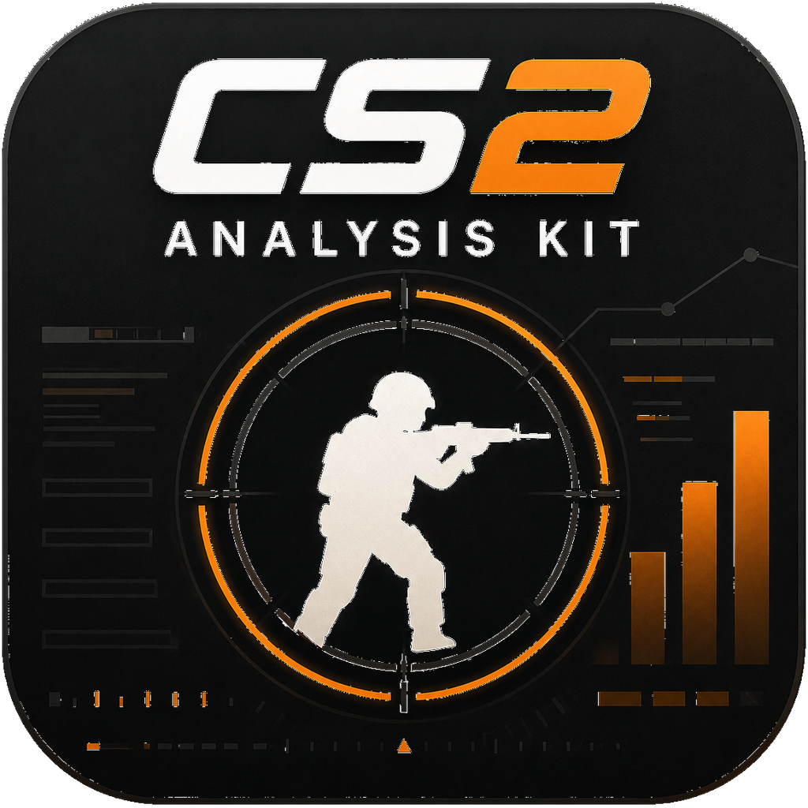

<div align="center">



# CS2 Demo Analysis Kit

**本地优先的 CS2 demo 分析——每一项统计都能点回具体的回合与 tick。**

[English](./README.md) · 简体中文

[](https://github.com/Starfie1d1272/cs2-demo-analysis-kit/actions)
[](https://github.com/Starfie1d1272/cs2-demo-analysis-kit/releases/latest)
[](#许可证)
[](https://pypi.org/project/cs2df/)

</div>

---

**DAK Studio** 是一个桌面工作台，把 CS2 的 `.dem` 变成完整的分析会话：单场复盘与 2D 回放、选手和队伍分析、战术材料与训练流程。一切都在你本机运行与保存——无账号、不上传、无服务端。

本仓库同时是支撑 Studio 的**产品中立管道**：一组 `@cs2dak/*` 包，把 `cs2-demo-format/3.x` ZIP 转成可复用的分析结果与 View Model，供 Studio 以及 RivalHub、CS2 Insight Agent 等产品消费。

> **Query-first，拒绝黑盒。** Studio 里每一个数字都能点回具体的比赛、回合与 tick，并在 2D 回放里亲眼复核。我们透明地派生信号，绝不给出一个你无法追溯的评分。

## 下载

从 [**Releases**](https://github.com/Starfie1d1272/cs2-demo-analysis-kit/releases/latest) 下载最新构建：

| 平台 | 文件 | 首次打开 |
|---|---|---|
| macOS | `dak-studio-X.Y.Z.dmg` | 拖入 Applications → 系统设置 → 隐私与安全性 → **仍要打开**（当前未签名） |
| Windows | `DAK-Studio-Setup-X.Y.Z.exe` | 运行安装器，选择安装目录，SmartScreen 选 **仍要运行** |

Windows 便携使用 `dak-studio-windows-X.Y.Z-full.zip`。它包含运行时和内置赛事资料，但 `.tri` 碰撞几何需要按需联网下载；缺失时相关分析会按能力提示降级。较小的 `dak-studio-windows-X.Y.Z.zip` 只含运行时，主要用于排障。

如果安装过相同数字版本的 RC，请手动安装正式版，不保证出现更新提示。升级前请备份资料。Windows 上从 0.8.5 或更早版本升级时，请先关闭 Studio，再运行安装器并选择原安装目录，安装器会保留用户资料。详见[更新记录](CHANGELOG.md)与[发布说明](docs/release.md)。

应用内置 exporter——点 **导入 demo**，选 `.dem`（或 v3 ZIP），本机解析入库，无需其他工具。

## Studio 能做什么

- **工作台**：导入 demo、继续最近比赛与分析、创建材料。
- **比赛库**：浏览比赛与赛事，在单场复盘中查看回合、选手和回放证据。
- **分析**：按选定范围探索表现、交火、经济、道具、开局控图、位置和职责。
- **战术与训练**：管理笔记、战术、人员职责和比赛单，并引用比赛证据。
- **数据管理**：维护身份、资产与资料库，包括重建和备份入口。

保存分析记录条件与页面状态，重开时按当前资料库重新计算；Markdown 和 JSON 导出记录生成时的结果、来源与限制。详见 [Studio 当前指南](apps/dak-studio/README.md)和[模块成熟度](docs/stability-tiers.md)。

## 架构

```text
.dem → cs2df → v3 ZIP → @cs2dak/demo-io → DemoPackage
  → @cs2dak/core          单场事实与 QA
  → @cs2dak/tactics       空间、对枪与战术分析
  → @cs2dak/analytics     评分信号、洞察与 UI 投影
  → @cs2dak/rating        RR / PRISM 公式适配
  → @cs2dak/cohort        评分行聚合

@cs2dak/pipeline          编排完整分析流程
已有 UI 数据 → @cs2dak/presentation → @cs2dak/react → 宿主产品
```

v3 ZIP 是 Python 与 TypeScript 之间唯一的接缝。输入、事实、评分、地图资产、分析和 UI 分属独立包；消费者按需选择。完整入口与包职责见[架构说明](docs/architecture.md)和[模块边界](docs/module-boundaries.md)。

| 包 | 职责 |
|---|---|
| `@cs2dak/contract` | 输入与基础事实 schema；编译固定的上游格式 schema 和声明。 |
| `@cs2dak/demo-io` | ZIP 加载、流选择和输入诊断。 |
| `@cs2dak/core` | 单场事件归属、事实、QA 与冻结赛事投影。 |
| `@cs2dak/rating` / `cohort` | RR/PRISM 公式适配与跨场评分聚合。 |
| `@cs2dak/maps` / `map-assets` | 地图算法与独立地图资产加载。 |
| `@cs2dak/tactics` / `tournament` | 空间战术分析与身份安全的赛事聚合。 |
| `@cs2dak/analytics` / `pipeline` | 信号派生、洞察投影与分析流程编排。 |
| `@cs2dak/presentation` / `react` | 展示模型、格式化与受控 React 组件。 |
| `@cs2dak/cli` | demo-io 与 pipeline 的私有文件系统适配器。 |
| `apps/dak-studio` / `python/src/cs2dak` | 本地工作台、桌面桥与打包壳。 |

## 开发

```bash
pnpm install
pnpm dev:studio        # DAK Studio（端口 5178，.dem 导入走本地 uv 环境）
pnpm dev               # pnpm dev:studio 的别名
pnpm test              # 快速 Vitest 测试（排除 *.integration.test.ts）
pnpm test:integration  # 关键流程：真实 ZIP 导入、必需流拒绝、可选流降级
pnpm test:all          # 全量
pnpm typecheck         # 全工作区 tsc -b
pnpm analyze:sample    # CLI 分析示例 ZIP → fixtures/output/sample/
bash scripts/package.sh  # 打包桌面应用（DMG / exe）
```

Demo 导出直接用 `cs2df` CLI：

```bash
cd python && uv sync --extra gui     # 装 pywebview（GUI/Studio 桥需要）
uv run cs2df export <demo.dem>       # 单场 .dem → v3 ZIP
uv run cs2df export-batch <dir> --out bundle.zip --descriptive
```

## 消费者与边界

DAK 是**产品中立的分析层**。产品负责业务逻辑、身份、持久化与品牌 UI，且不得重建评分 / 聚合 / 展示公式。

- **RivalHub**（云端赛事平台）通过**版本化数据接缝**对接，而非运行时共享源码——分阶段方案见 [docs/integration.md](docs/integration.md)（先数据 API，后选择性包共享）。
- **CS2 Insight Agent** 产出原始 `.dem`，用 `cs2df` 导出 v3 ZIP，再跑 `cs2dak analyze` 做对话式分析。
- **rival-rating** 拥有 RR/PRISM 公式与校准；`@cs2dak/rating` 编译固定的上游实现，analytics 派生信号，pipeline 编排流程。
- **cs2-demo-format** 拥有 v3 ZIP 合同；contract 编译固定的上游 schema 与声明，并在产物中记录来源哈希和许可证。

## 文档

| 文档 | 内容 |
|---|---|
| [docs/architecture.md](docs/architecture.md) | 数据流、组件职责、v3 ZIP 接缝、评分三层 |
| [docs/module-boundaries.md](docs/module-boundaries.md) | 各模块 owner：做什么、不做什么 |
| [docs/design/studio-redesign.md](docs/design/studio-redesign.md) | Studio 完整模块设计（9 模块） |
| [docs/stability-tiers.md](docs/stability-tiers.md) | 各模块 Stable / Beta / Experimental 成熟度 |
| [docs/integration.md](docs/integration.md) | RivalHub 与 CS2 Insight Agent 集成、分阶段数据接缝 |
| [docs/design/rr-model.md](docs/design/rr-model.md) | RR v1 / 六账户 / PRISM 设计 |
| [docs/roadmap.md](docs/roadmap.md) | 0.5 / 0.6 / 0.7 方向 |
| [docs/release.md](docs/release.md) | 桌面（git tag）与 npm（changesets）发布流程 |

## 许可证

按「生态 / 产品」双轨许可：

- **生态 —— MIT**：全部 `@cs2dak/*` 包、Python 壳（`python/`）。与 `cs2-demo-format`、`@rivalhub/rival-rating` 同侧——欢迎任何人基于格式与管道构建自己的工具。
- **产品 —— AGPL-3.0-only**：`apps/dak-studio`（DAK Studio 桌面应用，见 [apps/dak-studio/LICENSE](apps/dak-studio/LICENSE)）。自用与修改自由；分发或以网络服务提供衍生版本时必须开源。

边界纪律与模块规则一致：产品代码（AGPL）可依赖生态包（MIT）；生态包绝不回流引用产品代码。第三方移植与改编出处见 [THIRD-PARTY-NOTICES.md](THIRD-PARTY-NOTICES.md)。

## 致谢

参考但不复制：[CS Demo Manager](https://github.com/akiver/cs-demo-manager)（工作台结构）、[AWPy](https://github.com/pnxenopoulos/awpy)（分析严谨性）、[CS2 2D Demo Viewer](https://github.com/sparkoo/csgo-2d-demo-viewer)（回放 frame model）、[pr1maly](https://github.com/pr1malator/pr1maly)（local-first 思路，非商业 license，仅产品研究）。
