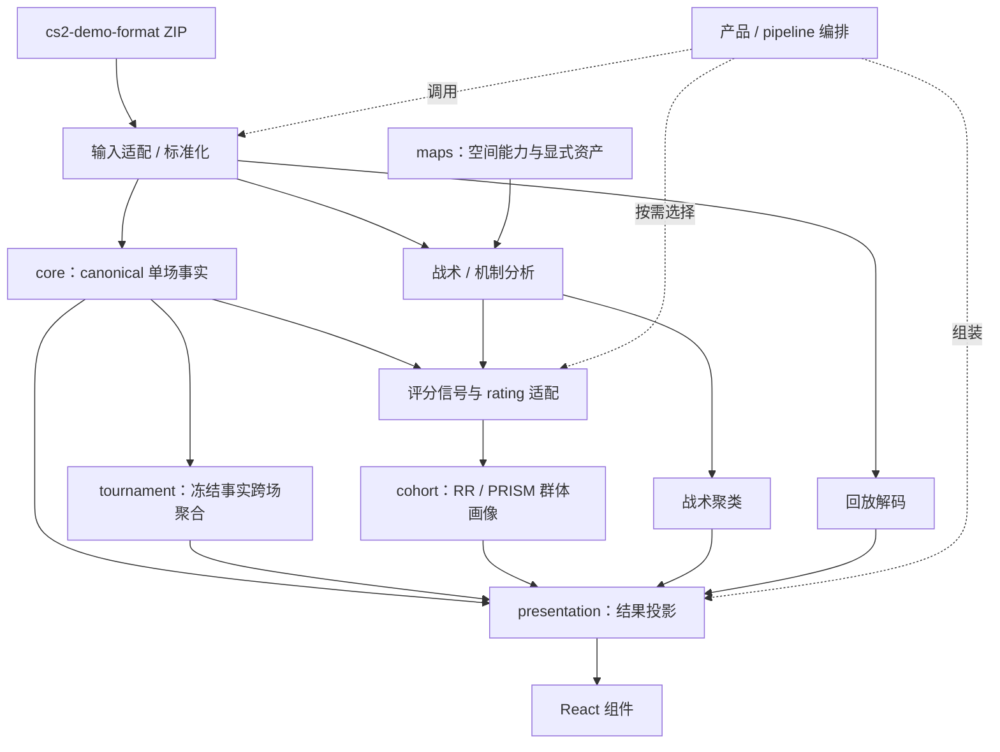

# DAK 包领域边界整理方案

日期：2026-11-01。审阅基线：main `48d37cc`。
状态：整体领域重构已落地。下文保留原审阅基线和分批提案；当前规则见 `docs/module-boundaries.md`，最终落点及验收见文末。

## 结论

外部复用应以独立能力为入口：展示已有数据、计算单场事实、计算评分、聚合多场事实、解码回放。当前按 core / cohort / presentation 分层的包，把这些能力组合得过早。最先应拆开“分析执行”与“展示消费”，随后拆开事实和评分，最后按实际消费者决定独立发布边界。

现有 tournament 已具备窄输入合同和零 runtime 依赖，保留其独立边界。避免把它重新并入通用 core 或统一 contract。

## 初始审阅方法与证据范围

检查各包 manifest、公共入口及关键调用链，并只读查看本地 RivalHub 和 CS2 Insight Agent 消费代码。初始审阅阶段未安装依赖、构建、跑测试、重算 Demo 或查询 registry。以下区分当前代码事实、既有审计记录和目标设计。外部仓库未同步远端，只代表本地快照。

基线中的七个公共包均声明 dist JS / declaration exports。历史发布产物治理已有仓外 tgz 验证记录，见 [2026-10-11 artifact audit](public-package-artifact-audit.md)。那份记录的包体积和测试成功属于当时基线，初始审阅阶段没有复测。不能据历史失败断言当前 npm 包仍无法使用，也不能据本地 exports 断言 registry 已发布当前代码。

## 重构前耦合的具体位置

| 事实 | 代码依据 | 对复用的影响 |
|---|---|---|
| React 安装闭包覆盖全部七个公共包 | `packages/react/package.json` → presentation → cohort/core → contract/maps/tournament | 仅渲染表格的项目也安装分析依赖；type-only 引用不会消除 manifest 安装依赖 |
| 组件运行时引用 presentation 根入口 | `react/src/components/MatchWorkspace.tsx`、`KillFeed.tsx`、`EconomyPanel.tsx` | formatter 与完整分析编排共享入口；原生 ESM 会遍历静态依赖，bundler 是否裁剪需另测 |
| 展示工作台入口执行完整单场分析 | `presentation/src/workspace.ts` 的 `buildMatchWorkspaceModel` 调用 normalize、canonical facts 和 `analyzeDemoPackage` | 已有事实的消费者缺少对等的轻量工作台投影入口 |
| 默认单场分析计算 RR 并构建完整输出 | `core/src/index.ts` 的 `analyzeDemoPackage` | 事实消费与评分、热力图、时间线耦合；细粒度函数虽存在，主入口仍是组合流程 |
| cohort 同一根模块包含原始 Demo 提取与事实行聚合 | `cohort/src/index.ts` 的 `buildSeasonCohort` / `buildSeasonCohortFromRows` | 已有 rows 的项目仍安装 core，根模块还静态 import core；现有 FromRows 是可保留的拆分接缝 |
| contract 同时导出原始 schema、评分、聚合结果、页面及赛事展示模型 | `contract/src/index.ts`、`workspace.ts`、`analysis.ts`、`cohort.ts` | UI 声明跟随上游 format、Zod、rating；跨领域类型集中演化 |
| insights 集中装入领域计算与报告排版 | `presentation/src/insights.ts` | `buildMatchBuyQuality` 计算经济分组胜率和手枪后续转化；UI 调用的 helper 与 Core facts/机制分析位于同一模块 |
| maps 的资产与基础坐标变换共同发布 | `maps/package.json` 的 files；`maps/src/index.ts` | calibration 子入口已隔离模块加载，但安装仍包含空间资产；未测本轮安装耗时，暂不据此拆资产包 |
| 评分/格式的上游分发适配进入 DAK build | `scripts/build-public-package.mjs`、`scripts/lib/bundled-dependencies.mjs` | DAK 维护固定上游编译及 provenance；它是分发问题，与领域划分分开治理 |

`buildMatchBuyQuality` 与 tournament 的经济统计需要逐字段核对分母和回合范围后迁移；本次只确认其包含领域计算，未判定两者数值等价。

本地 RivalHub `package.json` 仅依赖 `@cs2dak/tournament@1.1.1`，`src/lib/stats/tournament-query.ts` 直接使用聚合 API，说明窄事实边界已有消费案例。CS2 Insight Agent 的本地 TS/TSX/JSON 搜索没有发现 `@cs2dak/` 引用，不能推定它当前的集成报错或运行路径。

## 从需求推导边界

每个能力回答五个问题：输入是否需要原始 Demo，输出由谁定义，哪些业务规则由它裁决，能在哪个运行环境执行，消费者必须安装哪些包。

1. **原始数据**：cs2-demo-format / cs2df 拥有格式和导出。DAK 的输入适配处理自身的 profile、诊断和标准化；核对上游 API 后再决定 ZIP loader 的最终位置，保留唯一格式 schema owner。
2. **单场事实**：Core 拥有击杀归因、Opening、Trade、KAST、Utility 等 canonical semantics。计算一次，后续消费显式事实。身份、null、数据覆盖和 provenance 随事实传递。
3. **评分**：DAK 提取评分信号；rival-rating 拥有公式和基线。评分是事实的下游能力。空间信号可作为其显式输入，避免事实底座反向依赖评分。
4. **跨场聚合**：消费冻结事实或信号及显式稳定身份。Tournament 保持透明 performance/economy 聚合；cohort 收敛为群体画像和 RR/PRISM 编排。战术聚类独立于评分画像模块。
5. **展示**：消费已经生成的结果，仅做标签、格式和视图投影。React 接收可序列化 props 和交互回调。回放时钟、坐标投影属于展示能力，事件归因与胜率计算属于分析能力。
6. **产品编排**：Studio、Uploader、CLI 决定何时加载、执行、缓存、上传和刷新。共用的无状态执行流程可提为 pipeline；数据库、权限和产品导航留在 app。

领域边界先体现在模块输入输出。只有独立安装、独立运行环境或独立版本演化有实际需求时，才增加 npm 包。

## 建议目标图

箭头表示数据流；代码依赖指向提供输入合同/能力的 owner。

此图允许按用例只走一条分支。轻展示消费者直接传 ViewModel 给 UI，无需先执行上方各分支。

## 包与合同的落点

| 当前模块 | 建议最终职责 | 迁移策略 |
|---|---|---|
| contract | 暂作既有 API 的迁移入口 | 逐类明确 owner；原始类型归 format，事实归分析域，Tournament DTO 留 tournament，页面模型归展示域。避免一次性重命名所有类型 |
| core | 单场 canonical facts 与 QA | 将 `analyzeDemoPackage` 的全链编排移到 pipeline；事实实现、私有快照缓存和验证共同保留唯一实例 |
| 新的 rating adapter（暂定名） | 信号、公式接线、结果整形 | 移出 core 的评分编排；跨场评分由 cohort 复用。公式继续调用 rival-rating |
| cohort | 群体画像、RR/PRISM 聚合 | FromRows 作为窄入口；原始 Demo 遍历移到 pipeline，战术聚类划为独立领域模块 |
| tournament | 现有冻结事实 DTO 与透明聚合 | 保持独立；Core → Tournament 为 DTO/type 边，不引入反向 runtime 依赖 |
| presentation | 纯结果 → ViewModel、标签和报告 | 移出分析执行、经济统计、事实提取；数据提取与投影分成显式 API |
| react | 展示和交互 | 依赖轻展示合同/helper 和坐标变换；不经任何传递路径拉入 core/cohort/rating |
| maps | 基础空间算法和校准 | 保留 calibration 入口；资产由 provider 显式注入，实际安装成本证据支持时再独立分发 |
| 新的 pipeline（暂定名） | ZIP → 用户选择的分析结果 → ViewModel | 作为需要一站式使用者的便利入口；UI 和底层领域包均不依赖它 |
| rivalhub-upload | RivalHub 特定 Evidence 与上传适配 | 保持 private 产品适配，事实来自 canonical owner |

展示合同有两种合理落点：presentation 自持 `types` 入口，或独立的轻 `view-contract`。本方案优先让 presentation 整包变轻并自持类型；若 schema 校验和纯类型消费出现不同安装需求，再拆声明包。不能只把 `import` 改成 `import type` 就声称安装依赖已消除；公开 `.d.ts` 的依赖闭包也必须收敛。

战术/机制先做同仓领域模块。确认外部消费者需要独立安装后再拆包，避免“一个目录一个包”。Shared/utils 不承载领域规则；通用 helper 按最小依赖就近归属。

## 迁移批次及完成条件

### 第一批：打通已有数据 → UI

- 清点 React props 的实际字段，确定展示合同；保留 null、证据跳转和缺失值语义。
- 从 `insights.ts` 分开报告排版与经济/机制计算。`MatchWorkspace` 接收算好的经济结果；formatters、replay-clock 等保留轻展示 owner。
- 新增只接收结果的工作台投影入口；将 `buildMatchWorkspaceModel(input)` 的 normalize/facts/analyze 编排移到 pipeline。纯 replay 入口直接接受回放数据，避免要求完整评分模型。
- 清理 presentation/React 的声明和 manifest 闭包，增加按能力 subpath 以控制加载。subpath 不作为降低安装体积的替代证据。
- 同批迁移 Studio/CLI 调用及边界规则。旧组合 API 由已确定的 pipeline 承接，按公共版本策略移除旧入口；不在轻包内保留反向引用 pipeline 的 wrapper。

完成条件：仓外消费者只装 UI 所需包和 React peers，用固定 ViewModel 渲染记分板/回放；安装树、声明和浏览器产物均不经过 core/cohort/rating/JSZip。这里是未来迁移的验收设计，本次未执行。

### 第二批：事实与评分解耦

- 梳理 `scoreboard.ts`、`signals.ts`、`timeline.ts` 的输入，提取评分 adapter。
- 将默认全链分析组合放入 pipeline；基础事实 API 输出不要求 RR 字段。展示上缺少评分仍保持缺失语义，不能补零。
- 保留 canonical facts 的私有快照校验机制；禁止复制 owner 或序列化后错误宣称命中可信缓存。
- `buildSeasonCohortFromRows` 与原始 Demo 提取分离入口、文件和依赖；画像消费方只需要其信号/结果合同。

完成条件：仅计算基础 performance facts 的消费者无需安装 rating 或地图资产；需要空间信号的评分用例显式提供对应输入。使用现有事实 fixture 核对迁移前后的口径，评分结果不得因迁移改变。

### 第三批：空间与战术能力独立消费

- maps 明确 calibration、几何算法、静态资产、Node/browser 资产加载四类模块。
- 战术/机制分析消费明确的 replay/事件/资产输入，聚类消费已算好的回合特征。
- 分别记录外部轻 consumer 的安装闭包、产物大小及冷启动；据实际收益决定 maps-assets 和 tactics 是否独立发布。

完成条件：只使用雷达坐标的消费者不会加载空间资产；只有在拆分资产发布后，才宣称安装也不包含资产。Node 资产加载入口不会进入浏览器静态依赖图。

### 第四批：上游分发与正式消费验收

在 cs2-demo-format 和 rival-rating 各自仓库提供正式 JS/declarations 发布后，DAK 再移除 vendor 编译适配。先验证对应 registry 版本，避免把上游源码发布问题重新交给消费者。

随后分别验证 Node、浏览器和实际产品集成，记录具体 OS 和构建器。包可 import、静态类型通过、真实页面能用是不同的验收项。此步骤涉及另仓修改和发布，应按对应任务授权执行。

## 实施时同步更新的规则

初始审阅时 `docs/module-boundaries.md` 允许 presentation 依赖全部分析包。本批已同步修改 `scripts/check-package-boundaries.mjs`、manifest、exports、build 配置、消费检查与文档，增加“UI 的传递依赖闭包不得触达分析执行”的约束。

每批按职责组织可回滚提交，消费者迁移与公共入口变更一起交付。涉及缓存/持久事实版本时单独核查恢复路径。基础行为未变时不重算历史 Evidence；语义变化应独立设计和版本化。

最初审阅阶段只新增本方案并同步 main。随后按用户授权实施第一批，执行状态与验证证据由本轮交付记录说明。

## 第一批实际落点（已落地）

- 新增 `@cs2dak/analytics`，承接领域洞察、经济统计、事实提取及已有分析结果到展示模型的投影；输入 package/bundle/canonical facts 的入口为 `buildMatchWorkspaceFromAnalysis`。
- 新增 `@cs2dak/pipeline`，以 `analyzeMatchWorkspace` 编排标准化、Core 分析与 analytics 工作台投影。旧 presentation 分析入口删除，调用方迁到实际 owner。
- `presentation` 自持展示 schema 和窄 View DTO，仅依赖 maps/Zod。工作台、排行榜等纯展示合同迁出 contract；地图角色和雷达使用渲染所需字段的窄视图。
- `react` 消费 presentation 的展示合同、预计算结果和 maps/calibration；安装/声明闭包不再允许通向分析包。公共产物 gate 增加 UI 闭包与 browser bundle 检查，本轮执行结果见下。
- 本批没有拆分 Core 评分或 maps 资产。calibration 隔离模块加载，资产仍同包安装；上游分发编译适配继续由现有构建脚本维护。

与原提案相比，领域计算单独落入 analytics，pipeline 仅保留分析执行编排，避免把所有迁出的 presentation 代码集中成另一个混合包。正式发布不属于这份实施状态记录。

## 第一批验收记录（2026-11-01）

代码落点补充：React 提供 `/scoreboard`、`/table`、`/replay` 独立入口。记分板使用窄 `ScoreboardTableRow`，评分可为 null；ReplayViewer 只接收 WorkspaceReplay/MapView 及交互选项。宿主通过 DemoViewOptions 注入雷达图片 URL，默认 null；Studio 的相对资源路径归 library 层。

工作台使用 `workspace-0.2`，必填 buyQuality、players[].roundSummary 和 reportHighlights；analytics 预计算，presentation 只展示和排版。投影入口检查 source hash/map/tickrate/team、canonical player-round 行及 roster，防止输入错配。该 guard 不提供鉴权或任意篡改安全保证。

本轮已执行：

- 全部公共包构建、全工作区 typecheck、Studio production build。
- macOS / Node 26.9.0 仓外消费者实际安装本轮打包的三个 tgz；应用只声明 React 包及 peers，DAK 安装闭包为 maps、presentation、react。
- strict NodeNext（skipLibCheck=false）、Node ESM import、记分板 SSR，以及空回放和真实 14 回合回放 SSR。
- 六个消费入口的 browser bundle；独立 replay 的输入依赖图不包含完整 MatchWorkspace 或空间资产。

这些记录证明本轮源码产物的独立消费路径。未运行自动化测试套件，未完成浏览器交互、Windows 或完整 Linux tgz gate，未正式发布。maps 空间资产仍同包安装。

## 整体重构落点与验收（2026-11-01）

在 UI 分离之后，继续完成基础事实、评分、跨场画像、地图资产与战术能力的独立边界：

- core 仅依赖 contract 与 Tournament DTO；ZIP loader 移 demo-io，评分合同/公式接线移 rating，完整分析和原始 Demo cohort 编排移 pipeline。
- analytics 提取评分信号和跨域投影；cohort 只消费已有行，依赖 rating/Zod；战术聚类和空间/交战分析归 tactics。
- maps 只发布算法，map-assets 独立发布数据和 Node/browser loader。maps tgz 约 38 KB 压缩 / 118 KB 解压；map-assets 约 3.57 MB / 18.78 MB，数值随包文档小幅变化。
- format 与原版 rival-rating 为精确 build-only 输入，vendor 同时编译 JS 和完整声明，保留源/声明哈希、许可证和 provenance。外部消费者不安装这两个源码包。
- 原入口直接删除；迁移对照见根 README、各包 README 与本轮 changeset。

最终验收记录：

- 十三个公共包统一构建、全工作区 TypeScript 检查通过；Studio 与 uploader production build 通过，构建仍有大 chunk 提示。
- ZIP/Trade、上传 Evidence/pipeline、Studio library persistence 共五个相关测试文件，38 条通过。
- macOS / Node 26.9.0 下十三个真实 tgz 的仓外安装、完整 strict NodeNext 声明、Node ESM 与实际 API 消费全部通过。实测 DAK 闭包：core = core/contract/tournament；cohort = cohort/rating；react = react/maps/presentation。
- UI SSR 与 browser bundle 消费通过。地图专项验证覆盖 JSON 公开出口、Node/browser loader、tri API、strict NodeNext，以及卸载 map-assets 后 maps root/calibration 独立加载。

以上是本轮本机验证。未进行浏览器交互或 Windows 验收，未执行完整 Linux tgz gate，未正式发布。

## 合并前行为与 CI 复核

对比 main `48d37cc` 与重构提交 `91ff245`，分别独立构建，在同一 Node 26.9.0 环境执行 Nuke、Inferno、Ancient 三份已提交 ZIP fixture。三份完整 AnalysisBundle 深比较一致；生成的 Markdown 报告、工作台初始 SSR HTML 和记分板 SSR HTML 均逐字一致。模型差异限于已声明的 workspace-0.2 合同、预计算字段及展示侧移除的非数值标识。该对比覆盖这些固定输入和初始渲染，交互事件另经完整代码 diff 审阅。

PR #128 首轮 CI 发现 Windows 的 tsc 路径格式差异，以及重复构建时类型检查声明与发布声明共用 dist。修复将项目引用类型检查产物移至 `.typecheck`，发布构建继续独占 dist；Windows 对 compiler 输出按平台路径规则规范化，源哈希与目录边界断言保留。本地按“串行构建 → 全工作区类型检查 → 串行再构建”复现验证修复。
